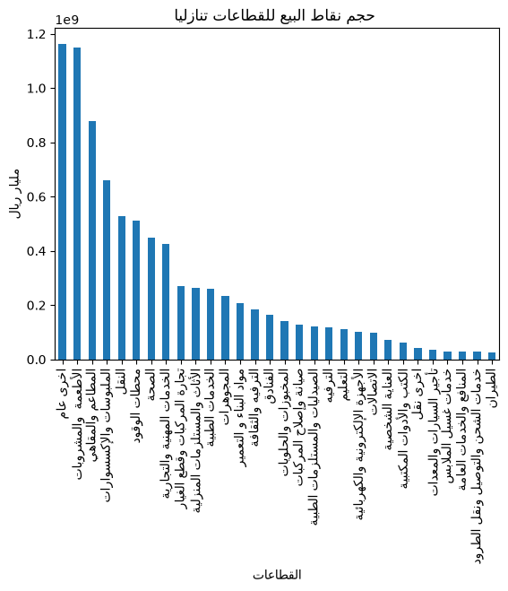
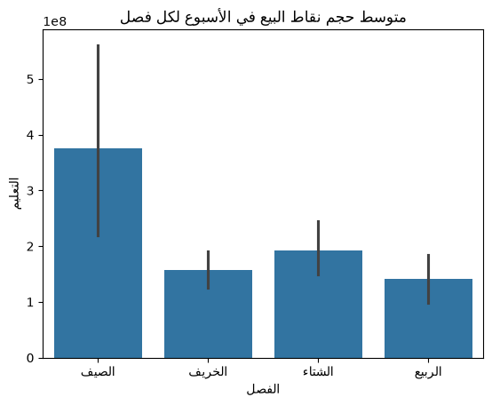

# تحليل استكشافي عن عمليات نقاط البيع 2025/08/24 - 2026/08/23

## المقدمة 
نقاط البيع (POS) هي عمليات الدفع التي تتم لشراء السلع أو الخدمات باستخدام البطاقات أو وسائل الدفع الإلكترونية، مثل مدى وVisa وMastercard.

### الهدف
النظر في نشاط القطاعات واختلافها خلال العام بحسب الموسم (فترة الدراسة , الاجازة الصيفية, رمضان والعيد, الاجازات القصيرة)
 وتم اختيار هذا التقسيم لانها فترات يلاحظ فيها اختلاف سلوك الناس 
### البيانات
 تشمل مختلف القطاعات وحجم نقاط البيع في الاسبوع لكل قطاع منها
 ### تنوية
 نقاط البيع لا تمثل كل النشاط الموجود في القطاع حيث انها لا تشمل المبيعات من التجارة الالكترونية فمن الصعب المقارنة بين القطاعات في هذة البيانات. 
 ولكن لا يرال بالإمكان مقارنة القطاع بالنفسة بحسب اختلاف الاوقات
 ### Repository Structure
 ```
### Repository Structure

```text
pos-eda/
│
├── data/
│   ├── pos.csv
│   └── pos_clean.csv
│
├── notebooks/
│   ├── data_cleaning.ipynb     # cleaning
│   └── eda.ipynb               # Main analysis notebook
│
├── plot/
│   ├── corr.png
│   ├── corr1.png
│   ├── corr2.png
│   ├── corr3.png
│   ├── corr4.png
│   ├── edu.png
│   ├── flight.png
│   ├── gas.png
│   ├── jey.png
│   ├── line.png
│   ├── personal_care.png
│   ├── rest_cafe.png
│   ├── ship.png
│   ├── sweet_baker.png
│   └── total.png
│
└── README.md
```
### أعمدة البيانات

| اسم العمود                       | النوع          | الوصف                                                     |
| -------------------------------- | -------------- | --------------------------------------------------------- |
| التاريخ                          | datetime64[us] | تاريخ بيانات نقاط البيع                                   |
| النقل                            | float64        | قيمة عمليات نقاط البيع في قطاع النقل                      |
| الطيران                          | float64        | قيمة عمليات نقاط البيع في قطاع الطيران                    |
| تأجير السيارات والمعدات          | float64        | قيمة عمليات نقاط البيع في تأجير السيارات والمعدات         |
| تجارة المركبات وقطع الغيار       | float64        | قيمة عمليات نقاط البيع في تجارة المركبات وقطع الغيار      |
| صيانة وإصلاح المركبات            | float64        | قيمة عمليات نقاط البيع في صيانة وإصلاح المركبات           |
| خدمات الشحن والتوصيل ونقل الطرود | float64        | قيمة عمليات نقاط البيع في الشحن والتوصيل ونقل الطرود      |
| أخرى نقل                        | float64        | قيمة عمليات نقاط البيع في الأنشطة الأخرى                  |
| الصحة                            | float64        | قيمة عمليات نقاط البيع في قطاع الصحة                      |
| الخدمات الطبية                   | float64        | قيمة عمليات نقاط البيع في الخدمات الطبية                  |
| الصيدليات والمستلزمات الطبية     | float64        | قيمة عمليات نقاط البيع في الصيدليات والمستلزمات الطبية    |
| العناية الشخصية                  | float64        | قيمة عمليات نقاط البيع في العناية الشخصية                 |
| المطاعم والمقاهي                 | float64        | قيمة عمليات نقاط البيع في المطاعم والمقاهي                |
| المخبوزات والحلويات              | float64        | قيمة عمليات نقاط البيع في المخبوزات والحلويات             |
| الفنادق                          | float64        | قيمة عمليات نقاط البيع في الفنادق                         |
| الأطعمة والمشروبات               | float64        | قيمة عمليات نقاط البيع في الأطعمة والمشروبات              |
| الملبوسات والإكسسوارات           | float64        | قيمة عمليات نقاط البيع في الملبوسات والإكسسوارات          |
| الترفيه والثقافة                 | float64        | قيمة عمليات نقاط البيع في الترفيه والثقافة                |
| الكتب والأدوات المكتبية          | float64        | قيمة عمليات نقاط البيع في الكتب والأدوات المكتبية         |
| الترفيه                          | float64        | قيمة عمليات نقاط البيع في الترفيه                         |
| الخدمات المهنية والتجارية        | float64        | قيمة عمليات نقاط البيع في الخدمات المهنية والتجارية       |
| الأجهزة الإلكترونية والكهربائية  | float64        | قيمة عمليات نقاط البيع في الأجهزة الإلكترونية والكهربائية |
| الأثاث والمستلزمات المنزلية      | float64        | قيمة عمليات نقاط البيع في الأثاث والمستلزمات المنزلية     |
| مواد البناء والتعمير             | float64        | قيمة عمليات نقاط البيع في مواد البناء والتعمير            |
| المجوهرات                        | float64        | قيمة عمليات نقاط البيع في المجوهرات                       |
| الاتصالات                        | float64        | قيمة عمليات نقاط البيع في الاتصالات                       |
| التعليم                          | float64        | قيمة عمليات نقاط البيع في التعليم                         |
| المنافع والخدمات العامة          | float64        | قيمة عمليات نقاط البيع في المنافع والخدمات العامة         |
| محطات الوقود                     | float64        | قيمة عمليات نقاط البيع في محطات الوقود                    |
| خدمات غسيل الملابس               | float64        | قيمة عمليات نقاط البيع في خدمات غسيل الملابس              |
| أخرى عام                         | float64        | قيمة عمليات نقاط البيع في الأنشطة الأخرى                  |
| الإجمالي                         | float64        | إجمالي قيمة عمليات نقاط البيع لجميع القطاعات              |
| الشهر                            | int32          | الشهر المستخرج من التاريخ                                 |
| الفصل                            | object         | الفصل من السنة                                            |
| الموسم                           | category       | (فترة الدراسة , الاجازة الصيفية, رمضان والعيد, الاجازات القصيرة)                         |

## سير عمل التحليل

### 1.تنظيف البيانات
- تحويل التواريخ من اعمدة الى صفوف وجعل القطاعات هي الاعمدة
- التعامل مع القيم المتكررة
-  تحويل نوع البيانات الي النوع المناسب
- ### 2.اضافة اعمدة ( Feature Engineering)
- اضافة عمود الشهر
- اضافة عمود الفصل
- اضافة عمود الموسم (فترة الدراسة , الاجازة الصيفية, رمضان والعيد, الاجازات القصيرة)
### 3. تحليل اختلاف نشاط القطاع بحسب الموسم
### 4. البحث عن ترابط في القطاعات

## التحليل
اكثر القاعات نشاطا



قطاع التعليم يشهد نشاط في الاجارة ذلك بسبب قرب مواعيد الدراسة



قطاع الطيران ي

